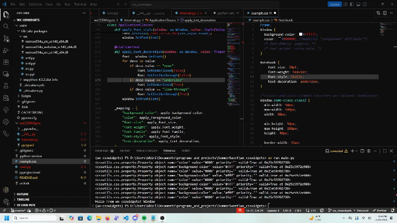

# wxcss

> [!IMPORTANT]
> wxcss its not affiliated with the developers of WxWidgets or WxPython
> It simply works _with_ WxPython and is a library to extend it. Thats it.
> The developers of WxWidgets/WxPython will not assist you with bugs in this library.

Wxcss is a very basic package that adds a handful of helper methods that allow you to style widgets using css.

# Demo



> Gif showing multiple edits being made to the css and them being applied once the application is reloaded.

## Basic API

```python

import wxcss
# ... wx imports

class AppFrame(wx.Frame):
    ...

class MyApp(wx.App):
    def OnInit(self):
        self.frame = AppFrame(None, wx.ID_ANY, "")
        self.SetTopWindow(self.frame)
        self.frame.Show()
        return True

if __name__ == "__main__":
    app = MyApp(0)

    with open("data/default.css", "r") as f:
        css_data = f.read()
        wxcss.apply_css(css_data, app.frame)

    app.MainLoop()
```

### Apply CSS class to Window/Widget

```python
import wxcss

class MyWidget(wx.Window):
    def __init__(self, *args, **kwargs):
        super().__init__(*args, **kwargs)

        wxcss.set_class(self, "my-css-class")
```

## Working CSS Features

Below will show you a css example containing all available changeable css properties

```css
/* applied to Frame and Window objects*/
Frame,
Window {
  background-color: #ffffff;
  color: #000000; /*modifies "foreground" attribute"*/
  font-family: papyrus;
  font-size: 10px;
  font-weight: heavier;
  font-style: italic;
  text-decoration: underline;
}

/*classes and class element selectors are allowed. Combinators are not supported :( */
Window.some-class {
  min-width: 50px;
  max-width: 100px;
  width: 80x;

  min-height: 50px;
  max-height: 100px;
  height: 80px;

  border-width: 15px;
}
```
