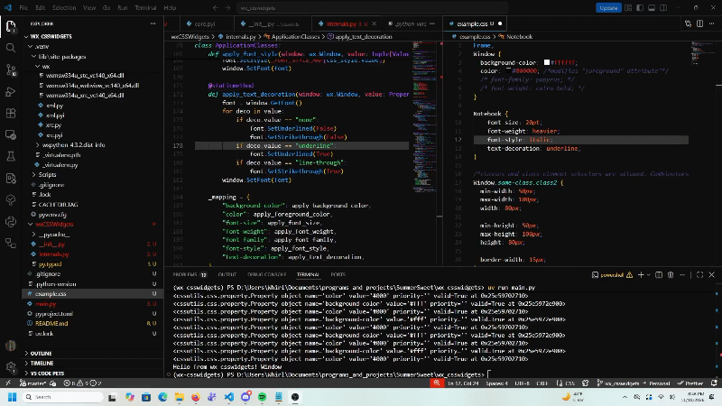

wxcss documentation
=====================

Wxcss is a small, work-in-progress library to add css support to WxPython.

The actual API is very, very small so the documentation for it will be contained
within one or two pages of docs.

The more pressing thing here is documentating which css properties are supported and allowed.

Demo gif
---------

.. toctree::
	:glob:
	:caption: Wxcss
	:hidden:

	self
	api_reference

.. toctree::
    :glob:
    :maxdepth: 2
    :caption: css-features
    :hidden:

    cssproperties/index.rst

    cssproperties/selectors.rst

    cssproperties/font-family.rst
    cssproperties/font-size.rst
    cssproperties/font-weight.rst
    cssproperties/font-style.rst
    cssproperties/font-decoration.rst

    cssproperties/color.rst
    cssproperties/background-color.rst

    cssproperties/content.rst

    cssproperties/margin.rst
    cssproperties/margin-left.rst
    cssproperties/margin-right.rst

    cssproperties/padding.rst

    cssproperties/border-width.rst
    cssproperties/border-style.rst
    cssproperties/border-style-top.rst
    cssproperties/border-style-bottom.rst
    cssproperties/border-style-left.rst
    cssproperties/border-style-right.rst

    cssproperties/width.rst
    cssproperties/height.rst
    cssproperties/min-width.rst
    cssproperties/min-height.rst
    cssproperties/max-width.rst
    cssproperties/max-height.rst

